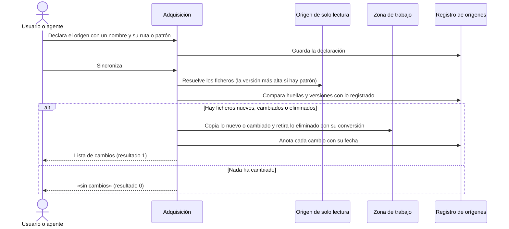

# Adquisición de Orígenes Documentales

## 1. Objetivo y Descripción

La adquisición de orígenes trae a una zona de trabajo local una copia de los documentos que
acompañan al proyecto documentado —manuales, especificaciones, normativa— cuando viven en
sitios que no se deben tocar: una carpeta compartida de red, una biblioteca de SharePoint
sincronizada en el equipo con el cliente de OneDrive o cualquier carpeta local de solo
lectura. Es la Fase 0-pre de [Documentar un Proyecto](document_project.md): las fases
siguientes (conversión a Markdown, copia en `_fuentes/`, evidencia) trabajan solo sobre esa
copia, y el origen nunca se escribe.

Cada origen se declara una vez con un nombre y una ruta, y después se sincroniza tantas veces
como haga falta: solo se copia lo nuevo o cambiado, se retira lo que ha desaparecido del
origen y se deja constancia de cada cambio en un registro con su fecha. Cuando un manual se
publica con la versión en el nombre del fichero, se indica un patrón y se elige siempre la
versión más alta; la copia lleva un nombre estable sin la versión, de modo que las rutas que
cita la documentación no cambian al publicarse una versión nueva y el registro guarda la
evolución de una versión a la siguiente.

La usan quienes preparan una sesión de documentación con material que no está en el
repositorio del proyecto. Todo el proceso es local y determinista: no accede a la red (las
carpetas de red y SharePoint se leen como rutas del sistema de ficheros) ni consulta servicios
IA.

## 2. Precondiciones

- Una raíz del destino (la carpeta que contiene o contendrá `mkdocs.yml`), indicada siempre
  de forma explícita.
- Cada origen accesible como ruta del sistema de ficheros: un fichero, una carpeta (incluidas
  las rutas de red) o un patrón de fichero con la marca de versión `{ver}` en el nombre.
- Para SharePoint u OneDrive: la biblioteca sincronizada en local con el cliente de OneDrive.
- Para un patrón con versión: la carpeta del patrón existe y al menos un fichero encaja con él.
- Los repositorios remotos no se adquieren con esta herramienta: se obtienen antes con git o
  glab (ver [Documentar un Proyecto](document_project.md)).

## 3. Flujo Principal

El usuario (o el agente, durante la Fase 0-pre) declara cada origen con un nombre, que será
la carpeta de su copia, y su ruta. Al sincronizar, la herramienta resuelve qué ficheros aporta
cada origen, calcula la huella de cada uno y la compara con la registrada. Lo nuevo o cambiado
se copia a la zona de trabajo; lo que ya no está en el origen se retira. En ambos casos se
borra también la conversión a Markdown anterior de ese fichero, para que la conversión
posterior lo vuelva a procesar. Por último se anota cada cambio en el registro y se informa
con un resultado distinto según haya habido cambios o no.

## 4. Postcondiciones y Efectos

- **Declarar**: añade o actualiza la entrada del origen en `.ai/sources.json` de la raíz del
  destino, sin copiar nada y conservando lo ya sincronizado.
- **Sincronizar**: la carpeta `_staging/<nombre>/` de la raíz del destino contiene la copia de
  los ficheros actuales del origen; las conversiones a Markdown de los ficheros cambiados o
  retirados ya no existen; el registro guarda, por fichero, su huella, su tamaño, su ruta en
  el origen y la versión detectada, y un historial de altas, modificaciones y bajas con su
  fecha (y la versión anterior cuando cambia).
- **Sincronizar sin cambios**: no modifica nada.
- **Simulación**: informa de los cambios que se harían sin copiar ni escribir el registro.
- **Listar**: muestra cada origen declarado, sus ficheros, su versión y el inicio de su huella;
  no modifica nada.
- El origen no se modifica nunca.

## 5. Reglas de Negocio

| Regla | Descripción | Impacto si se viola |
|---|---|---|
| El origen nunca se escribe | La herramienta solo lee del origen; copia, conversión y registro viven en la raíz del destino | Ficheros ajenos (conversiones, bloqueos) creados en una carpeta compartida o en una biblioteca de SharePoint |
| Versión más alta, comparada como número | Con un patrón con versión se elige el fichero de versión más alta comparando cada tramo como número (1.2.50 es mayor que 1.2.9) | Se documentaría con una versión antigua del manual al ordenar las versiones como texto |
| Nombre estable sin versión | La copia de un patrón con versión se guarda sin la versión ni su separador (`Manual_Modulo_v1.2.50.docx` → `Manual_Modulo.docx`); un patrón que no deja nombre útil sin la versión se rechaza | Cada versión nueva cambiaría las rutas de `_fuentes/`, de la evidencia y de las fuentes selladas |
| Solo el formato del patrón | Con un patrón con versión solo cuentan los ficheros con la extensión del patrón; las copias en otros formatos del mismo documento se ignoran | Se mezclarían el `.docx` y su `.pdf` como si fueran versiones distintas |
| Solo lo cambiado se copia | Un fichero se vuelve a copiar si cambia su huella o su versión, o si falta su copia en la zona de trabajo | Copias completas en cada sesión, o una copia borrada a mano que nunca se repone |
| Un cambio invalida su conversión | Al copiar o retirar un fichero se borra su conversión a Markdown en la zona de trabajo | La conversión posterior omitiría el fichero cambiado y la documentación seguiría citando el texto anterior |
| Todo cambio queda registrado | Cada alta, modificación o baja se anota con su fecha y, al cambiar de versión, con la versión anterior; el registro se guarda tras cada origen sincronizado | No se podría saber qué versión del manual respalda la documentación ni cuándo cambió |
| Un origen caído no frena a los demás | Si un origen falla, se informa y se continúa con el resto; el resultado final indica el error | Una unidad de red desconectada dejaría sin actualizar todos los demás orígenes |
| Lo que no es documento se omite | En una carpeta se omiten la conversión a Markdown previa, las carpetas ocultas y de control de versiones, la zona de trabajo y los ficheros de bloqueo de Office y de metadatos del sistema | Se copiarían ficheros temporales o conversiones viejas como si fueran documentos del origen |
| Sin red ni servicios IA | Todo origen es una ruta del sistema de ficheros; el registro se escribe con orden estable | Dependencia de credenciales o de conexión; registros con diferencias espurias en git |

## 6. Límites, Flujos Alternativos y Casos Especiales

### Qué NO hace esta funcionalidad

- No descarga nada de la red: SharePoint se lee a través de la biblioteca sincronizada y los
  repositorios remotos se obtienen antes con git o glab.
- No convierte los documentos a Markdown: lo hace después la conversión, sobre la zona de
  trabajo.
- No decide el tipo de cada origen ni qué páginas enriquece: eso corresponde a la
  [clasificación de orígenes](origin_types.md).
- No excluye del control de versiones la zona de trabajo: esa regla la aplica el flujo de
  documentación en el destino.
- No elige entre versiones por fecha ni por contenido: solo por el número del nombre.

### Flujos alternativos

- **Simulación**: con la opción de simulación se listan los cambios previstos, no se copia
  nada ni se escribe el registro, y el resultado es el mismo que tendría la sincronización real.
- **Sincronizar solo algunos orígenes**: se indican por nombre; los no declarados se rechazan.
- **Un origen inaccesible** (unidad de red desconectada, carpeta sin permisos): se informa el
  error de ese origen, los demás se sincronizan y quedan registrados, y el resultado es 2.
- **Origen inexistente o ilegible**, patrón sin ningún fichero que encaje o marca de versión
  fuera del nombre del fichero: error de ese origen con su motivo y resultado 2.
- **Nombre de origen con caracteres no admitidos** o filtro de ficheros junto a un patrón con
  versión: la declaración se rechaza con su motivo y resultado 2.
- **Sin orígenes declarados**: la sincronización lo indica y termina sin cambios.

### Casos especiales

- **Versión nueva de un manual**: la copia conserva su ruta, se informa el paso de una
  versión a otra y el registro anota la versión anterior.
- **Copia borrada a mano en la zona de trabajo**: la siguiente sincronización la repone como
  modificación.
- **Fichero eliminado del origen**: se retira de la zona de trabajo junto con su conversión y
  se anota como baja.
- **Carpeta con subcarpetas**: se recorre entera; las copias conservan la ruta relativa y el
  filtro de ficheros acepta tanto el nombre como la ruta relativa.
- **Redeclarar un origen**: cambia su ruta o su filtro sin perder lo ya sincronizado ni su
  historial.

## 7. Criterios de Aceptación

| ID | Dado | Cuando | Entonces | Test |
|---|---|---|---|---|
| AC-01 | Versiones 1.2.9, 1.2.10 y 1.2.50 de un manual, más una copia en otra extensión y otro manual | Se resuelve el patrón con versión | Se elige 1.2.50 con el nombre estable sin versión; 1.2.50 es mayor que 1.2.9 | `tests/test_snapshot_sources.py::test_version_key_compares_numerically`, `tests/test_snapshot_sources.py::test_resolve_versioned_picks_highest_version` |
| AC-02 | Patrones con la versión precedida de `_v`, espacio, `-V` o al principio del nombre | Se calcula el nombre estable | Desaparecen la versión y su separador; un patrón sin nombre útil sin la versión se rechaza | `tests/test_snapshot_sources.py::test_stable_name_strips_version_and_separator`, `tests/test_snapshot_sources.py::test_stable_name_without_stem_is_an_error` |
| AC-03 | Un patrón con versión con el que no encaja ningún fichero | Se resuelve el origen | Error que indica que ningún fichero encaja | `tests/test_snapshot_sources.py::test_resolve_versioned_without_match_is_an_error` |
| AC-04 | Una carpeta con subcarpetas, una conversión previa, un bloqueo de Office y una carpeta de control de versiones | Se resuelve el origen, con y sin filtro | Solo se toman los documentos, con su ruta relativa; el filtro deja los que encajan | `tests/test_snapshot_sources.py::test_resolve_directory_filters_and_skips_generated` |
| AC-05 | Un origen que no existe | Se resuelve o se sincroniza | Error de origen inexistente; la sincronización termina con resultado 2 | `tests/test_snapshot_sources.py::test_resolve_missing_origin_is_an_error`, `tests/test_snapshot_sources.py::test_sync_missing_origin_exit_2` |
| AC-06 | Un manual con versión ya sincronizado y convertido, del que se publica una versión nueva | Se sincroniza de nuevo | La copia conserva su ruta con el contenido nuevo, la conversión anterior desaparece, se informa el cambio de versión y el historial registra alta y modificación con la versión anterior; sin cambios, el resultado es 0 | `tests/test_snapshot_sources.py::test_sync_versioned_file_records_evolution` |
| AC-07 | Una carpeta sincronizada en la que un documento cambia y otro desaparece | Se sincroniza de nuevo | El cambiado se copia; el eliminado y su conversión se retiran; el historial termina en modificación y baja | `tests/test_snapshot_sources.py::test_sync_directory_detects_modified_and_removed` |
| AC-08 | Un origen declarado y nunca sincronizado | Se sincroniza en simulación | Resultado 1, sin zona de trabajo creada ni ficheros registrados | `tests/test_snapshot_sources.py::test_sync_dry_run_copies_nothing` |
| AC-09 | Una copia borrada a mano de la zona de trabajo | Se sincroniza | La copia se repone y el resultado es 1 | `tests/test_snapshot_sources.py::test_sync_restores_deleted_staging_copy` |
| AC-10 | Una carpeta de origen | Se declara y se sincroniza | El contenido del origen no cambia | `tests/test_snapshot_sources.py::test_sync_never_writes_into_the_origin` |
| AC-11 | Un nombre de origen con espacios, un filtro junto a un patrón con versión o la sincronización de un origen no declarado | Se ejecuta la operación | Error con su motivo y resultado 2 | `tests/test_snapshot_sources.py::test_errors_exit_2` |
| AC-12 | Un manual con versión sincronizado | Se listan los orígenes | Aparece el nombre estable con su versión | `tests/test_snapshot_sources.py::test_list_shows_versions` |
| AC-13 | Dos orígenes declarados, uno en una unidad desconectada | Se sincronizan todos | El resultado es 2, pero el origen accesible queda copiado y registrado; una nueva sincronización de ese origen no encuentra cambios | `tests/test_snapshot_sources.py::test_sync_failing_origin_does_not_lose_the_others` |

Verificación: `python -m pytest tests/test_snapshot_sources.py -q`.

## 8. Glosario de Dominio

| Término | Definición |
|---|---|
| Origen | Fichero, carpeta o patrón con versión del que se toma material para documentar; se declara con un nombre |
| Zona de trabajo (`_staging/`) | Carpeta de la raíz del destino con una subcarpeta por origen, donde vive la copia local sobre la que trabajan las fases siguientes |
| Registro de orígenes (`.ai/sources.json`) | Fichero de la raíz del destino con la declaración de cada origen, la huella y versión de cada fichero copiado y su historial; lo escribe la herramienta |
| Patrón con versión | Ruta de fichero con la marca `{ver}` donde va el número de versión, p. ej. `Manual_Modulo_v{ver}.docx` |
| Nombre estable | Nombre de la copia sin la versión ni su separador; no cambia al publicarse una versión nueva |
| Huella | Resumen SHA256 del contenido de un fichero; cambia cuando cambia el fichero |
| Alta / modificación / baja | Tipos de cambio del historial: fichero nuevo, fichero cambiado (o copia repuesta) y fichero que ya no está en el origen |
| Fase 0-pre | Paso de [Documentar un Proyecto](document_project.md) que adquiere los orígenes antes de clasificarlos |

??? note "Evidencia"

    | Elemento | Fuente | Confianza |
    |---|---|---|
    | Zona de trabajo y registro en la raíz del destino | `scripts/snapshot_sources.py::STAGING_DIR`, `::MANIFEST`, `::_manifest_path` | ✅ |
    | Declarar sin copiar y conservar lo sincronizado | `scripts/snapshot_sources.py::declare`, `::_cmd_add` | ✅ |
    | Regla «El origen nunca se escribe» | `scripts/snapshot_sources.py::sync_source` (solo escribe bajo `root`), `tests/test_snapshot_sources.py::test_sync_never_writes_into_the_origin` | ✅ |
    | Regla «Versión más alta, comparada como número» | `scripts/snapshot_sources.py::version_key`, `::resolve_versioned` | ✅ |
    | Regla «Nombre estable sin versión» | `scripts/snapshot_sources.py::stable_name`, `::STABLE_NAME_RE` | ✅ |
    | Regla «Solo el formato del patrón» | `scripts/snapshot_sources.py::resolve_versioned` (`fullmatch` del nombre completo) | ✅ |
    | Regla «Solo lo cambiado se copia» | `scripts/snapshot_sources.py::sync_source` (`unchanged`) | ✅ |
    | Regla «Un cambio invalida su conversión» | `scripts/snapshot_sources.py::_invalidate`, `::md_twin` | ✅ |
    | Regla «Todo cambio queda registrado» | `scripts/snapshot_sources.py::sync_source` (`historial`, `version_anterior`) | ✅ |
    | Regla «Lo que no es documento se omite» | `scripts/snapshot_sources.py::SKIP_DIRS`, `::SKIP_FILES`, `::_skipped` | ✅ |
    | Regla «Sin red ni servicios IA» y orden estable | `scripts/snapshot_sources.py::resolve`, `::write_manifest` (`sorted`) | ✅ |
    | Simulación y resultados 0, 1 y 2 | `scripts/snapshot_sources.py::_cmd_sync`, `::main` | ✅ |
    | Regla «Un origen caído no frena a los demás» | `scripts/snapshot_sources.py::_cmd_sync` (`failed`, `write_manifest` tras cada origen) | ✅ |
    | Errores de declaración y de origen | `scripts/snapshot_sources.py::declare`, `::resolve_versioned`, `::resolve`, `::SnapshotError` | ✅ |
    | Listar | `scripts/snapshot_sources.py::_cmd_list` | ✅ |
    | Repositorios remotos y SharePoint fuera de la herramienta | `scripts/snapshot_sources.py` (docstring del módulo) | ✅ |
    | AC-01 – AC-13 | `tests/test_snapshot_sources.py` | ✅ |
