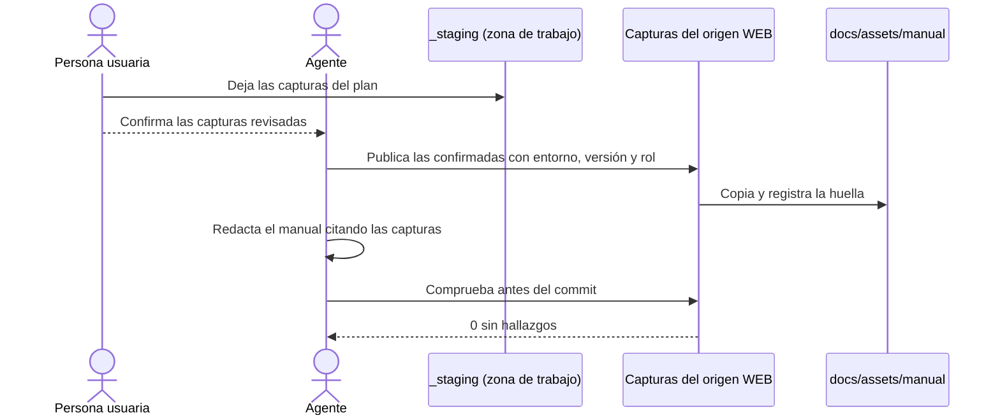

# Capturas del Origen WEB

## 1. Objetivo y Descripción

El manual de funcionamiento (Arquetipo 15) describe una aplicación tal como está **desplegada**
en un entorno, por ejemplo PRE, y se apoya en capturas de sus pantallas. Esas capturas pueden
mostrar datos personales reales e información interna, y una vez publicadas quedan en el
historial del repositorio de documentación.

Esta funcionalidad controla la entrada de las capturas en la documentación. **Publicar** copia a
`docs/assets/manual/<origen>/` solo las capturas que una persona ha revisado y las registra con
su huella, el entorno, la versión desplegada y el rol con el que se tomaron. **Comprobar** detecta
cualquier imagen que haya entrado sin publicar o haya cambiado después, las capturas que nadie
cita, las citas rotas o sin texto alternativo y cualquier URL escrita en el registro.

No toma capturas ni abre la aplicación: trabaja solo con ficheros, sin red. Las capturas las
aporta el usuario o se toman en el chat durante un recorrido de solo lectura
([Documentar un Proyecto](document_project.md), opción `WEB`).

## 2. Precondiciones

- Capturas en `_staging/<origen>/` de la raíz del destino, normalmente copiadas con
  [Adquirir Orígenes Documentales](snapshot_sources.md).
- Revisión humana de cada captura que se va a publicar: sin datos personales reales. Decide la
  persona usuaria; el agente publica solo lo que ella confirma.
- Entorno y versión desplegada que se ven en las capturas.

## 3. Flujo Principal

1. La persona usuaria deja en la zona de trabajo las capturas del plan de capturas.
2. Revisa cada una y confirma cuáles pueden publicarse.
3. El agente publica solo esas, indicando el entorno, la versión desplegada y, si aplica, el rol.
4. El agente redacta el manual: cada página cita sus capturas con texto alternativo.
5. Antes del commit, la comprobación debe terminar sin hallazgos.

## 4. Postcondiciones y Efectos

- Las capturas publicadas están en `docs/assets/manual/<origen>/` con la misma ruta relativa que
  en la zona de trabajo.
- `.ai/captures.json` registra, por origen, el entorno y la última versión, y por captura su
  huella SHA256, la versión, la fecha de publicación y el rol.
- Las capturas no publicadas siguen solo en `_staging/`, que no se versiona.
- La comprobación no modifica nada.

## 5. Reglas de Negocio

| Regla | Descripción | Impacto si se viola |
|---|---|---|
| Solo lo revisado | Se publican únicamente las capturas que se indican expresamente | Una captura con datos reales llegaría al historial del repositorio |
| Nada a mano | Toda imagen de `docs/assets/manual/` pasa por la publicación; la comprobación detecta las demás (`sin_registrar`) y las cambiadas después (`modificada`) | Imágenes sin revisar en la documentación |
| La URL no se versiona | El entorno y la versión no pueden ser una URL, y la comprobación avisa si el registro contiene una | La dirección interna del entorno quedaría publicada |
| Todo o nada | Se validan todas las capturas antes de copiar ninguna | Publicaciones a medias |
| Dentro del origen | Las rutas de captura no pueden salir de `_staging/<origen>/` y deben ser imágenes | Se publicarían ficheros ajenos al origen |
| Accesibilidad | Toda cita lleva texto alternativo | Manual inaccesible para lectores de pantalla |

## 6. Límites, Flujos Alternativos y Casos Especiales

### Qué NO hace esta funcionalidad

- No toma capturas, no abre la aplicación ni accede a la red.
- No anonimiza imágenes: una captura con datos reales se repite con datos ficticios o se excluye.
- No decide qué captura está revisada: lo decide una persona.
- No redacta el manual.

### Flujos alternativos

- **Captura republicada**: publicar de nuevo una captura sustituye el fichero y su huella; las
  páginas que la declaran en `fuentes:` aparecen en el `drift` de la trazabilidad.
- **Versión desplegada nueva**: la publicación actualiza la versión del origen; cada captura
  conserva la versión con la que se publicó.

### Casos especiales

- Las citas dentro de bloques de código (también indentados en admoniciones) y de código inline
  no se comprueban.
- Las imágenes con referencia (`![texto][ref]`) no se reconocen: la captura aparece como
  `huerfana`; se cita con la forma directa.
- Las imágenes fuera de `assets/manual/` (logotipos, diagramas) no se comprueban.
- Se reconocen las citas Markdown (``, también con atributos `{ … }`) y las
  etiquetas `` con comillas dobles o simples.
- Un nombre de origen formado solo por puntos (`.`, `..`) se rechaza: saldría de la zona de
  trabajo.
- Un registro editado a mano con un origen mal formado se rechaza con un error, sin comprobar
  nada.

## 7. Criterios de Aceptación

| ID | Dado | Cuando | Entonces | Test |
|---|---|---|---|---|
| AC-01 | Dos capturas en la zona de trabajo y una sola revisada | Se publica la revisada | Solo ella llega a `docs/assets/manual/` y queda registrada con entorno, versión, rol, fecha y huella | `tests/test_web_captures.py::test_publish_copies_only_listed_captures_and_registers_them` |
| AC-02 | Un entorno o una versión que son una URL, o un entorno vacío | Se publica | Error y no se escribe el registro | `tests/test_web_captures.py::test_publish_rejects_urls_and_empty_metadata` |
| AC-03 | Una lista con una captura fuera del origen, inexistente o que no es imagen | Se publica | Error y no se copia ninguna | `tests/test_web_captures.py::test_publish_validates_every_capture_before_copying` |
| AC-04 | Una captura publicada y citada con texto alternativo | Se comprueba | Sin hallazgos | `tests/test_web_captures.py::test_check_is_clean_when_published_and_cited_with_alt` |
| AC-05 | Una imagen copiada a mano, una editada, una borrada y una sin citar | Se comprueba | `sin_registrar`, `modificada`, `falta` y `huerfana` | `tests/test_web_captures.py::test_check_reports_unregistered_modified_missing_and_orphan` |
| AC-06 | Una cita sin texto alternativo, una rota, otra en un bloque de código y un logotipo | Se comprueba | `sin_alt` y `rota`; el bloque de código y el logotipo se ignoran | `tests/test_web_captures.py::test_check_reports_missing_alt_and_broken_links_but_ignores_code` |
| AC-07 | Un registro con una URL | Se comprueba | `url` | `tests/test_web_captures.py::test_check_flags_a_url_written_into_the_manifest` |
| AC-09 | Un nombre de origen `.`, `..`, con `/` o vacío | Se publica | Error y no se escribe nada | `tests/test_web_captures.py::test_publish_rejects_origin_names_that_leave_staging` |
| AC-10 | Una cita en un bloque de código indentado, otra en código inline y un `` con comillas simples | Se comprueba | Solo cuenta el ``, que cita la captura publicada: sin hallazgos | `tests/test_web_captures.py::test_check_ignores_indented_fences_and_inline_code_and_reads_single_quotes` |
| AC-11 | Un registro con un origen que no es un objeto | Se comprueba | Error con el nombre del origen y resultado 2 | `tests/test_web_captures.py::test_check_rejects_a_malformed_manifest_entry` |
| AC-08 | Un destino sin capturas, una publicación válida, una sin citar y una con URL | Se ejecuta la herramienta | Resultados 0, 0, 1 y 2; el error no repite la URL | `tests/test_web_captures.py::test_cli_exit_codes` |

Verificación: `python -m pytest tests/test_web_captures.py -q`.

## 8. Glosario de Dominio

| Término | Definición |
|---|---|
| Origen WEB | La aplicación desplegada en un entorno, usada como fuente del manual de funcionamiento |
| Captura revisada | Captura que una persona ha comprobado que no contiene datos personales reales |
| Publicar | Copiar una captura revisada a la documentación y registrarla |
| Entorno | Instalación concreta de la aplicación (PRE, PRO…); se nombra, nunca se escribe su URL |
| Versión desplegada | Versión de la aplicación que se ve en el entorno, declarada por el usuario |

??? note "Evidencia"

    | Elemento | Fuente | Confianza |
    |---|---|---|
    | Regla «Solo lo revisado» y «Todo o nada» | `scripts/web_captures.py::publish` | ✅ |
    | Regla «Nada a mano» | `scripts/web_captures.py::check` (`sin_registrar`, `modificada`) | ✅ |
    | Regla «La URL no se versiona» | `scripts/web_captures.py::_require_text`, `::check` (`url`) | ✅ |
    | Regla «Dentro del origen» | `scripts/web_captures.py::_capture_rel`, `::NAME_RE` | ✅ |
    | Registro mal formado | `scripts/web_captures.py::read_manifest` | ✅ |
    | Regla «Accesibilidad» y citas reconocidas | `scripts/web_captures.py::_references`, `::check` (`sin_alt`) | ✅ |
    | Uso en la Fase 0-pre, la Fase 6 y el CIERRE | `.github/prompts/document_project.prompt.md::Origen WEB` | ✅ |
    | AC-01 – AC-11 | `tests/test_web_captures.py` | ✅ |
