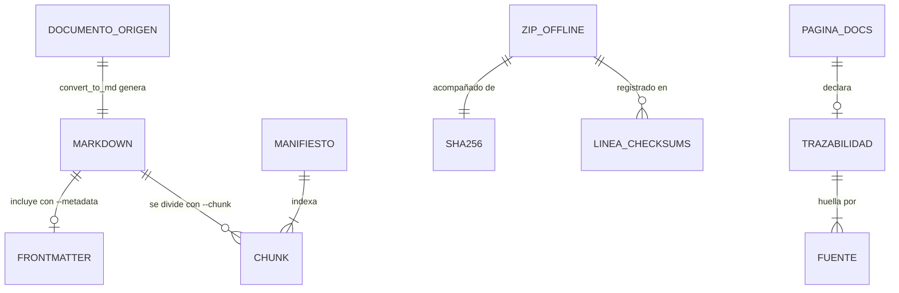

# Referencia — doc_ia

Superficie que consulta quien ejecuta u opera el tooling de doc_ia: configuración, comandos de
línea de comandos, códigos de salida y eventos de build. La API interna de cada script está en
[Referencia Técnica](../api/check_env.md).

## 1. Configuración

| Clave | Origen | Tipo | Por defecto | Descripción |
|---|---|---|---|---|
| `CUDA_VISIBLE_DEVICES` | `env` | cadena | `""` (lo fija `convert_to_md.py` al importarse si no existe) | Visibilidad de GPU para docling. `--device cpu` la fija a `""`; `--device cuda` la elimina; `--device auto` respeta un valor exportado por el usuario e ignora el que fija el propio módulo |
| `project.version` | fichero `pyproject.toml` | cadena SemVer | `0.10.0` (valor actual) | Versión usada en el nombre del ZIP (`doc_ia-docs-{versión}.zip`) y en la release `docs-v{versión}` |
| `site_dir` | fichero `mkdocs.yml` | ruta | `site` | Directorio de salida del build; `mkdocs_hooks.py` lo lee de la configuración. `build_docs_zip.py` usa `site/` fijo |
| `use_directory_urls` | fichero `mkdocs.yml` | booleano | `false` | URLs `*.html`: el sitio y el ZIP se abren con doble clic en `index.html` (el plugin `offline` lo fuerza igualmente) |
| `plugins: offline` | fichero `mkdocs.yml` | plugin | activo | Escribe el índice de búsqueda como JS (`search/search_index.js`; Zensical: `search.js`) para buscar desde `file://` |
| `extra.polyfills` | fichero `mkdocs.yml` | lista de rutas | `assets/vendor/iframe-worker/iframe-worker-shim-1.0.4.min.js` | Shim local para la búsqueda desde `file://`; sin una ruta con `iframe-worker`, el tema añade la de unpkg y `build_docs_zip.py` termina con `1` |
| `hooks` | fichero `mkdocs.yml` | lista de rutas | `hooks/sync_root_docs.py`, `mkdocs_hooks.py` | Hooks MkDocs cargados en cada build (ver §4). Zensical los ignora: con `--builder zensical`, `build_docs_zip.py` los ejecuta él mismo |
| `hooks.PostToolUse` | fichero `.claude/settings.json` (no versionado; plantilla en `.claude/settings.json.example`) | objeto JSON | `sync_root_docs.py` + ruff + mypy + pytest `--collect-only` sobre `Edit\|Write` | Sincronización y validaciones automáticas tras cada edición en Claude Code |

!!! note "Sin secretos"
    doc_ia no lee credenciales ni API keys. `.gitignore` excluye `.env`, `.env.*` y `*.key`.

## 2. CLI y Comandos

### build_docs_zip.py

```bash
python scripts/build_docs_zip.py [--builder {mkdocs,zensical}] [--no-strict] [--no-build] [--output-dir DIR]
```

| Opción / Argumento | Tipo | Por defecto | Descripción |
|---|---|---|---|
| `--builder` | `mkdocs` \| `zensical` | `mkdocs` | Generador usado en el build (`python -m <builder> build`). Con `zensical` ejecuta antes `hooks/sync_root_docs.py` y, si el build termina con `0`, `mkdocs_hooks.py` |
| `--no-strict` | flag | desactivado (build con `--strict`) | Construye sin `--strict` |
| `--no-build` | flag | desactivado | Omite el build y empaqueta el `site/` existente |
| `--output-dir` | ruta | `dist` | Directorio del ZIP; relativo a la raíz del repositorio si no es absoluto |

Salida: `{output-dir}/doc_ia-docs-{versión}.zip`, `.zip.sha256` y una línea añadida a `CHECKSUMS.txt`.

### check_env.py

```bash
python scripts/check_env.py
```

Sin opciones. Comprueba las herramientas obligatorias (`mkdocs`, `ruff`, `mypy`, `pytest`) y
avisa de las opcionales (`zensical`, `docling`, `markitdown` y sus plugins, `pandoc`).

### convert_to_md.py

```bash
python scripts/convert_to_md.py <source> [opciones]
```

| Opción / Argumento | Tipo | Por defecto | Descripción |
|---|---|---|---|
| `source` | ruta (obligatorio) | — | Fichero o directorio a convertir; la salida va a `<origen>/md/` |
| `--engine` | `docling` \| `markitdown` \| `pandoc` | `docling` | Motor de conversión |
| `--dry-run` | flag | desactivado | Muestra qué se convertiría sin convertir |
| `--validate-only` | flag | desactivado | Solo validación previa (tamaño, integridad ZIP, cabeceras) |
| `--force` | flag | desactivado | Re-convierte aunque exista el `.md` de salida |
| `--metadata` | flag | desactivado | Añade frontmatter YAML con metadatos |
| `--chunk` | flag | desactivado | Genera chunks para RAG (solo `docling`) |
| `--chunk-max-tokens` | entero | `512` | Tamaño máximo de chunk |
| `--ocr` / `--no-ocr` | flag | `--ocr` | Habilita o deshabilita OCR |
| `--ocr-engine` | `auto` \| `easyocr` \| `tesseract` \| `rapidocr` | `auto` | Motor OCR de docling |
| `--ocr-lang` | lista separada por comas | `es,en` | Idiomas OCR |
| `--table-mode` | `accurate` \| `fast` | `accurate` | Extracción de tablas (docling) |
| `--image-export` | `placeholder` \| `embedded` \| `referenced` | `placeholder` | Exportación de imágenes |
| `--pdf-backend` | `docling-parse` \| `pypdfium2` | `docling-parse` | Backend PDF de docling |
| `--timeout` | entero (segundos) | `300` | Timeout por documento |
| `--device` | `cpu` \| `cuda` \| `auto` | `cpu` | Dispositivo de cómputo; `auto` usa GPU si `nvidia-smi` la detecta, salvo que el usuario haya exportado `CUDA_VISIBLE_DEVICES=""` |
| `--num-threads` | entero | `4` | Hilos CPU de docling |
| `--flash-attention` | flag | desactivado | Flash Attention 2; requiere `--device cuda` o `auto` |
| `--batch-size` | entero | `1` | Documentos por lote; `>1` solo con `docling` |
| `--workers` | entero | `1` | Concurrencia por lote; `>1` solo con `docling` |

### db_trace.py

```bash
python scripts/db_trace.py info --export DIR
python scripts/db_trace.py select --export DIR --root DIR --name NOMBRE --env ENTORNO [--subdir bd] [--include PATRÓN …]
python scripts/db_trace.py compare --catalog FICHERO --entities FICHERO [--output FICHERO] [--include PATRÓN …]
python scripts/db_trace.py changes --catalog FICHERO --previous FICHERO [--docs DIR] [--subdir bd] [--include PATRÓN …]
python scripts/db_trace.py tracemap --catalog FICHERO --docs DIR --output FICHERO [--origin DIR] [--entities FICHERO] [--subdir bd] [--include PATRÓN …]
```

Origen BASE DE DATOS: lee la exportación Markdown de `util_bbdd` (`manifest.json` y
`docs/catalog.json`), la importa al destino, la contrasta con `entities.xml`, compara catálogos
y genera el `trace_map.toml` de `util_bbdd`. No se conecta a ninguna base de datos ni a la red.

| Opción / Argumento | Tipo | Por defecto | Descripción |
|---|---|---|---|
| `info --export` / `select --export` | ruta (obligatorio) | — | Carpeta de la exportación |
| `select --root` | ruta (obligatorio) | — | Raíz del destino |
| `select --name` | cadena (obligatorio) | — | Nombre del origen: carpeta `_fuentes/<nombre>/` |
| `select --env` | cadena (obligatorio) | — | Entorno que representa la exportación (p. ej. `Calidad`); en blanco, error |
| `--subdir` | cadena | `bd` | Sección importada dentro de `docs/` del destino (`select`); en `changes` y `tracemap`, carpeta que no cuenta como evidencia |
| `--include` | glob (repetible) | todos los objetos | Alcance por nombre, sin distinguir mayúsculas (`select`, `compare`, `changes`, `tracemap`) |
| `compare --catalog` | ruta (obligatorio) | — | Catálogo; normalmente `_fuentes/<nombre>/catalog.json` |
| `compare --entities` | ruta (obligatorio) | — | Modelo del código `entities.xml` (vdyn) |
| `compare --output` | ruta | solo stdout | Copia del informe Markdown |
| `changes --catalog` / `--previous` | ruta (obligatorio) | — | Catálogo nuevo (puede ser el completo de la exportación) y anterior (`_fuentes/<nombre>/catalog.json`); antes de `select` |
| `changes --docs` | ruta | sin búsqueda | `docs/` del destino: páginas que citan cada objeto |
| `tracemap --catalog` / `--docs` / `--output` | ruta (obligatorio) | — | Catálogo, `docs/` del destino y TOML de salida (`.ai/trace_map.toml`) |
| `tracemap --origin` | ruta | sin código | Repositorio del código (`git ls-files`) |
| `tracemap --entities` | ruta | sin entidades | `entities.xml` para buscar por entidad y localizar su código |

### doc_trace.py

```bash
python scripts/doc_trace.py [--root DIR] {drift,stamp,matrix,llms,decisions,baseline,changes} [opciones]
```

| Opción / Argumento | Tipo | Por defecto | Descripción |
|---|---|---|---|
| `--root` | ruta | raíz del repositorio | Base para resolver las fuentes del frontmatter (global, antes del subcomando) |
| `drift --docs` | ruta | `<--root>/docs` | Carpeta donde buscar páginas con frontmatter `fuentes` |
| `stamp <páginas…>` | rutas (obligatorio) | — | Páginas a sellar |
| `stamp --source` | ruta (repetible) | fuentes actuales del frontmatter | Ficheros de los que deriva la página; si se indica, **sustituye** la lista entera |
| `stamp --archetype` | cadena | el actual del frontmatter | Arquetipo de la página (`1`, `1-I`, `2`, `12`…) |
| `stamp --date` | `YYYY-MM-DD` | hoy | Fecha `revisado` |
| `matrix --docs` | ruta | `<--root>/docs` | Se leen los `AC-xx` de `<docs>/functional/*.md` |
| `matrix --tests` | ruta | `<--root>/tests` | Carpeta con `test_*.py` |
| `matrix --output` | ruta | stdout | Fichero Markdown de la matriz |
| `llms --config` | ruta | `<root>/mkdocs.yml` | Configuración con `site_name`, `site_url` y `nav` |
| `llms --output` | ruta | `<docs_dir>/llms.txt` junto a `--config` | Fichero generado (`docs_dir` por defecto: `docs`) |
| `llms --site-url` | URL | `site_url` de `mkdocs.yml` | Base de los enlaces |
| `llms --check` | flag | desactivado | Solo comprueba que el fichero está al día |
| `decisions --docs` | ruta | `<--root>/docs` | Docs del destino; los registros se leen de `<docs>/decisiones/*_decisiones.md` |
| `decisions --output` | ruta | stdout | Fichero Markdown del informe |
| `baseline` / `changes --origin` | ruta (obligatorio) | — | Raíz del origen documentado (git); puede ser una subcarpeta de un repositorio |
| `baseline` / `changes --name` | cadena | carpeta del origen | Clave del origen en el estado; con varios orígenes, la de `_fuentes/` |
| `baseline` / `changes --docs` | ruta | `<--root>/docs` | Docs del destino (citas y artefactos a excluir) |
| `baseline` / `changes --state` | ruta | `<--root>/.ai/doc_state.json` | Estado del modo incremental |
| `baseline` / `changes --path` | pathspec de git (repetible) | `.` en `baseline`; las `rutas` guardadas en `changes` | Alcance transversal relativo al origen (p. ej. un módulo funcional repartido entre varios módulos de build); en `changes` debe coincidir con el del baseline |
| `baseline --ref` | cadena | rama actual; con HEAD desacoplado, la única ref que apunta a él | Rama o ref documentada que se guarda en `rama` (p. ej. `origin/dev` en un worktree desacoplado) |
| `changes --output` | ruta | stdout | Fichero Markdown del informe |

### kit.py

```bash
python scripts/kit.py [--from DOC_IA] {install,sync} --root DIR [--force] [--dry-run] [--date YYYY-MM-DD]
python scripts/kit.py [--from DOC_IA] check --root DIR
```

Instala, actualiza y comprueba el kit de documentación de un destino: la metodología y los
scripts de la lista blanca `.github/kit/MANIFEST.txt` en `<--root>/.doc_ia/`, los lanzadores
`/documentar` y `DOCUMENTAR.md` (solo si falta). Se distribuye en el propio kit
(`<destino>/.doc_ia/scripts/kit.py`). No accede a la red.

| Opción / Argumento | Tipo | Por defecto | Descripción |
|---|---|---|---|
| `--from` | ruta | el doc_ia que contiene el script | doc_ia de origen; global, antes del subcomando. Obligatorio en `install`/`sync` desde una copia `.doc_ia/` |
| `install` / `sync` | subcomando | — | Alias: instalan o actualizan el kit |
| `check` | subcomando | — | Comprueba el kit contra `kit.lock.json`; con `--from`, también contra doc_ia |
| `--root` | ruta (obligatorio) | — | Raíz del destino (carpeta con `mkdocs.yml`); no puede ser doc_ia |
| `--force` | flag | desactivado | Sobrescribe ficheros del kit editados y ajenos; retira aunque estén editados |
| `--dry-run` | flag | desactivado | Informa sin escribir ficheros ni lock |
| `--date` | `YYYY-MM-DD` | hoy | Fecha del lock |

### snapshot_sources.py

```bash
python scripts/snapshot_sources.py --root DIR {add,replace,sync,list} [opciones]
```

Copia los orígenes documentales de solo lectura (fichero, carpeta, ruta UNC, biblioteca de
SharePoint sincronizada o patrón con `{ver}`) a `<--root>/_staging/<nombre>/` y registra
`<--root>/.ai/sources.json`. No escribe en el origen ni accede a la red.

| Opción / Argumento | Tipo | Por defecto | Descripción |
|---|---|---|---|
| `--root` | ruta (obligatorio) | — | Raíz del destino (carpeta con `mkdocs.yml`); global, antes del subcomando |
| `add <nombre>` | cadena (obligatorio) | — | Nombre del origen (`[\w.-]+`): carpeta en `_staging/` y `_fuentes/` |
| `add <origen>` | ruta o patrón (obligatorio) | — | Fichero, carpeta o patrón con `{ver}` en el nombre del fichero |
| `add --include` | glob (repetible) | todos los ficheros | Filtro para carpetas; no admitido con `{ver}` |
| `replace <nombre> <origen>` | cadenas (obligatorios) | — | Sustituye un origen ya declarado por un documento **reestructurado** que indica el usuario (manda aunque su versión sea menor); historial «sustituido» y retira `_staging/<nombre>/` |
| `replace --include` / `--date` | glob / `YYYY-MM-DD` | todos / hoy | Filtro para carpetas; fecha del evento del historial |
| `sync [nombres…]` | cadenas | todos los declarados | Orígenes a sincronizar |
| `sync --dry-run` | flag | desactivado | Informa sin copiar ni escribir el manifiesto |
| `sync --date` | `YYYY-MM-DD` | hoy | Fecha de los eventos del historial |

### redact_secrets.py

```bash
python scripts/redact_secrets.py <ruta> [<ruta> …] [--check]
```

Detecta credenciales en ficheros `.md` (recorrido recursivo en carpetas) y sustituye su valor por
`<REDACTADO>`; con `--check` solo informa. El informe nunca muestra el valor.

| Opción / Argumento | Tipo | Por defecto | Descripción |
|---|---|---|---|
| `<ruta>` | ruta (obligatorio, repetible) | — | Fichero `.md` o carpeta |
| `--check` | flag | desactivado | Informa sin modificar (CIERRE: sobre `_fuentes/`) |

### web_captures.py

```bash
python scripts/web_captures.py --root DIR publish ORIGEN CAPTURA [CAPTURA …] --env ENTORNO --version VERSIÓN [--role ROL] [--date YYYY-MM-DD]
python scripts/web_captures.py --root DIR check
```

Origen WEB (Arquetipo 15): copia a `<--root>/docs/assets/manual/<origen>/` solo las capturas
revisadas de `<--root>/_staging/<origen>/`, las registra en `<--root>/.ai/captures.json` y
comprueba imágenes, registro y citas del manual. No accede a la red ni abre un navegador.

| Opción / Argumento | Tipo | Por defecto | Descripción |
|---|---|---|---|
| `--root` | ruta (obligatorio) | — | Raíz del destino (carpeta con `mkdocs.yml`); global, antes del subcomando |
| `publish <origen>` | cadena (obligatorio) | — | Nombre del origen (`[\w.-]+`, no solo puntos): carpeta en `_staging/` |
| `publish <captura>…` | rutas (obligatorio) | — | Capturas revisadas, relativas a `_staging/<origen>/` (`.png`, `.jpg`, `.jpeg`, `.webp`, `.gif`) |
| `publish --env` / `--version` | cadenas (obligatorio) | — | Entorno (p. ej. `PRE`) y versión desplegada; nunca una URL |
| `publish --role` | cadena | — | Rol con el que se tomaron las capturas |
| `publish --date` | `YYYY-MM-DD` | hoy | Fecha de publicación |
| `check` | — | — | Hallazgos `sin_registrar`, `modificada`, `falta`, `rota`, `sin_alt`, `huerfana`, `url` |

### start-server.py

```bash
python start-server.py [--port PORT] [--no-browser]
```

Se distribuye en la raíz de los dos ZIP offline (`EXTRA_FILES` de `mkdocs_hooks.py` y de
`build_docs_zip.py`, junto a `VER_DOCUMENTACION.md`) y sirve el directorio donde está, solo en
`127.0.0.1`, con un hilo por conexión (una conexión ociosa del navegador no bloquea las
demás). Basta Python 3.7 o superior, sin paquetes. Si el puerto está ocupado, termina con
código 1 y sugiere `--port <puerto+1>`. Es la alternativa al doble clic en `index.html` (por
ejemplo, si una política de empresa bloquea los scripts de ficheros locales).

| Opción / Argumento | Tipo | Por defecto | Descripción |
|---|---|---|---|
| `--port` | entero | `8000` | Puerto HTTP local |
| `--no-browser` | flag | desactivado | No abre el navegador automáticamente |

### sync_root_docs.py

```bash
python hooks/sync_root_docs.py
```

Sin opciones. Copia `CHANGELOG.md` → `docs/changelog.md` y `CONTRIBUTING.md` → `docs/contributing.md`.

## 3. Errores y Códigos de Salida

| Código / Error | Origen | Cuándo ocurre | Acción recomendada |
|---|---|---|---|
| `0` | `build_docs_zip.py` | ZIP y checksums generados | — |
| `1` | `build_docs_zip.py` | `--no-build` sin `site/` existente | Ejecutar sin `--no-build` |
| `1` | `build_docs_zip.py` | `site/` no se abre sin servidor: falta `index.html` o el índice de búsqueda en JS, script remoto o enlace a carpeta (hasta 20 líneas `- <página>: <problema>` por stderr) | Revisar `use_directory_urls: false`, el plugin `offline` y el shim local en `extra.polyfills` |
| `≠ 0` (propagado) | `build_docs_zip.py` | El build del generador falla (p. ej. enlace roto con `--strict`) | Corregir los avisos del build |
| `2` | `build_docs_zip.py`, `convert_to_md.py`, `start-server.py` | Opción desconocida o valor fuera de `choices` (argparse) | Revisar la sinopsis del §2 |
| `0` | `check_env.py` | Herramientas obligatorias presentes (con o sin avisos de opcionales) | — |
| `1` | `check_env.py` | Falta alguna herramienta obligatoria | Instalar las listadas (`pip install -r requirements.txt`) |
| `0` | `convert_to_md.py` | Conversión completa, validación sin errores o ningún fichero convertible | — |
| `1` | `convert_to_md.py` | Origen inexistente, motor no instalado, errores de validación o de conversión, `--device cuda` sin `nvidia-smi` | Ver el mensaje `ERROR:`; instalar el motor o cambiar `--engine` |
| `2` | `convert_to_md.py` | Combinación inválida: `--chunk`, `--batch-size >1` o `--workers >1` sin `docling`; `--flash-attention` con `--device cpu` | Ajustar las opciones |
| `0` | `start-server.py` | Servidor detenido con Ctrl+C | — |
| `1` | `start-server.py` | Puerto ocupado: mensaje por stderr con la sugerencia `--port <puerto+1>` | Usar otro `--port` |
| `0` | `doc_trace.py` | Sin drift, sin tests citados inexistentes, `llms.txt` al día o sellado correcto | — |
| `1` | `doc_trace.py drift` | Alguna fuente o registro `stale`, `missing` u `outside_repo`, o un registro enlazado sin sellar (`unsealed`) | Revisar la página contra el cambio y re-sellar con `stamp` |
| `1` | `doc_trace.py stamp` | Página o fuente inexistente, fuente fuera del repositorio o página sin fuentes | Corregir la ruta o `--source` |
| `1` | `doc_trace.py matrix` | La columna `Test` cita un test que no existe | Corregir el criterio o crear el test |
| `1` | `doc_trace.py llms` | `mkdocs.yml` sin `nav` o ilegible; con `--check`, `llms.txt` no coincide con el `nav` actual | Revisar `--config`; ejecutar `llms` sin `--check` |
| `2` | `doc_trace.py` | Sin subcomando u opción desconocida (argparse) | Revisar la sinopsis del §2 |
| `0` | `doc_trace.py decisions` | Registros coherentes con la documentación (las fichas `Pendiente` no cuentan) o sin registros | — |
| `1` | `doc_trace.py decisions` | Hallazgos `duplicate`, `orphan_ref`, `orphan_entry`, `invalid`, `incomplete`, `unreflected` o `mismatch` | Aplicar la decisión en la página o pedir a la persona responsable que complete la ficha (`DOCUMENTATION_STANDARD.md` §3.18) |
| `0` | `doc_trace.py baseline` | Baseline guardado (también si el origen no usa git: `commit: null`) | — |
| `0` | `doc_trace.py changes` | Sin cambios en el origen desde el baseline | Todas las páginas siguen vigentes (estado C) |
| `1` | `doc_trace.py changes` | Hay ficheros cambiados | Inventariar solo el informe (modo incremental) |
| `3` | `doc_trace.py changes` | Sin baseline para el origen, origen sin git, commit fuera del historial o versión menor de doc_ia distinta | Documentar en modo completo; el CIERRE guardará un baseline nuevo |
| `3` | `doc_trace.py changes` | `--path` distinto del alcance guardado en el baseline | Repetir sin `--path` o documentar en modo completo con el nuevo alcance |
| `0` | `snapshot_sources.py` | `add` y `list` correctos; `sync` sin cambios | — |
| `1` | `snapshot_sources.py sync` | Algún fichero nuevo, cambiado o eliminado (también con `--dry-run`) | Convertir de nuevo lo cambiado (`convert_to_md.py`) y citar los cambios de versión en el resumen |
| `0` | `redact_secrets.py` | Sin credenciales | — |
| `1` | `redact_secrets.py` | Credenciales redactadas (o pendientes con `--check`) | Con `--check` sobre `_fuentes/`: redactar antes del commit; avisar de que el documento original sigue conteniéndolas |
| `2` | `redact_secrets.py` | Ruta inexistente, UTF-8 inválido u `OSError` | Corregir la ruta |
| `0` | `web_captures.py` | `publish` correcto; `check` sin hallazgos | — |
| `1` | `web_captures.py check` | Imagen sin registrar o modificada, captura que falta o huérfana, cita rota o sin texto alternativo, URL en el manifiesto | Publicar con `publish` (tras la revisión), retirar la imagen, citarla o corregir la cita antes del commit |
| `2` | `web_captures.py` | Origen inválido, entorno, versión o rol vacíos o con URL, captura fuera del origen, inexistente o que no es imagen (antes de copiar nada), manifiesto inválido, `OSError`; argparse | Ver `[captures] ERROR: …` por stderr |
| `2` | `snapshot_sources.py replace` | Origen no declarado, mismo origen que el declarado («usa `sync`») o documento nuevo inexistente; la declaración anterior se conserva | Corregir la ruta o usar `sync` para una versión nueva del mismo documento |
| `2` | `snapshot_sources.py` | Origen inexistente o ilegible, patrón sin coincidencias, nombre inválido, `--include` con `{ver}`, origen no declarado, manifiesto inválido u `OSError`; un origen caído no impide sincronizar los demás | Ver `[snapshot] ERROR…` por stderr; corregir la ruta o reconectar la unidad |
| `0` | `db_trace.py` | `info` y `tracemap` correctos; `select`, `compare` o `changes` sin cambios ni discrepancias | — |
| `1` | `db_trace.py select` | Páginas, índice o `_fuentes/` creados, actualizados o retirados | Revisar e incluir en el commit `docs/bd/` y `_fuentes/<nombre>/` |
| `1` | `db_trace.py compare` | Discrepancias código ↔ BD | Una ficha `COB-DATOS-…` por discrepancia; decide una persona |
| `1` | `db_trace.py changes` | Objetos del alcance con alta, baja o huella distinta | Revisar las páginas que los citan (candidatas a estado B) |
| `2` | `db_trace.py` | Exportación o catálogo inexistente, JSON inválido, `format`/`format_version` no admitidos, objeto del catálogo sin `id`/`kind`/`name`/`path`, `select` sin `--env` o con él en blanco, alcance sin coincidencias, páginas citadas inexistentes (antes de escribir nada), `entities.xml` inexistente o mal formado, `OSError`; argparse | Ver `[db_trace] ERROR: …` por stderr |
| `0` | `kit.py install`/`sync` | Kit al día: nada que copiar, crear ni retirar | — |
| `1` | `kit.py install`/`sync` | Ficheros creados, actualizados o retirados (también con `--dry-run`) | Revisar e incluir en el commit `.doc_ia/`, los lanzadores y `DOCUMENTAR.md` |
| `2` | `kit.py install`/`sync` | Conflicto: fichero del kit editado en el destino, fichero ajeno con el nombre de un lanzador o fichero retirado y editado | Revisar el fichero; `--force` solo si los cambios locales sobran |
| `0` | `kit.py check` | Kit al día (`[kit] Kit al día.`) | — |
| `1` | `kit.py check` | Kit no instalado, fichero editado o ausente, falta `DOCUMENTAR.md` o `.ai/prompts/documentar.prompt.md` o, con `--from`, fichero desfasado o nuevo en doc_ia | `kit.py sync` desde doc_ia; el prompt de instancia lo crea `/documentar` o el CIERRE |
| `2` | `kit.py` | `sync` desde una copia `.doc_ia/` sin `--from`, destino igual a doc_ia o inexistente, manifiesto mal formado o que cita un fichero inexistente, lock con JSON inválido u `OSError`; argparse | Ver `[kit] ERROR: …` por stderr |
| `0` | `sync_root_docs.py` | Siempre; un fichero raíz ausente solo genera un aviso | — |

## 4. Eventos y Mensajes

| Evento / Mensaje | Productor | Consumidor | Payload / formato |
|---|---|---|---|
| `on_pre_build` | MkDocs | `hooks/sync_root_docs.py` | Configuración MkDocs (`docs_dir`); copia los ficheros raíz a `docs/` |
| `on_post_build` | MkDocs | `mkdocs_hooks.py` | Configuración MkDocs (`site_dir`); genera `site/doc_ia-docs-latest.zip` + `.sha256`, con prioridad -200: después del plugin `offline`, para incluir el índice de búsqueda en JS |
| Pre/post-build sin hooks | `build_docs_zip.py --builder zensical` | `sync_root_docs.main()` / `mkdocs_hooks.on_post_build({"site_dir": ...})` | Mismo efecto que los dos eventos anteriores; el post-build solo si el build termina con `0` |
| `PostToolUse` (`Edit\|Write`) | Claude Code | Comandos de `.claude/settings.json` | Ejecuta `sync_root_docs.py`, ruff, mypy y pytest `--collect-only`; salida truncada a 5–15 líneas |
| Prefijos de log `[build_docs_zip]`, `[ZIP]`, `[OK]`, `[sync_root_docs]`, `[doc_ia-docs]`, `[doc_trace]`, `[snapshot]`, `[kit]`, `[db_trace]`, `[redact]`, `[captures]` | Scripts y hooks | Usuario / CI | Texto libre por stdout; sin contrato estable más allá del prefijo |

## 5. Interfaces Publicadas

| Interfaz | Tipo | Contrato fuente | Descripción |
|---|---|---|---|
| ZIP offline `doc_ia-docs-{versión}.zip` | Fichero de salida | `scripts/build_docs_zip.py::_zip` | Sitio HTML completo; nombre estable por versión |
| `doc_ia-docs-{versión}.zip.sha256` | Fichero de salida | `scripts/build_docs_zip.py::_create_checksum_files` | Formato `sha256sum`: `<hash>  <fichero>` |
| `CHECKSUMS.txt` | Fichero de salida (acumulativo) | `scripts/build_docs_zip.py::_create_checksum_files` | Una línea por build: `<hash>  <fichero>  (<ISO-8601>)` |
| Release `docs-v{versión}` | GitHub Release | `.github/workflows/docs-zip-release.yml` | ZIP + `.sha256` + `CHECKSUMS.txt`; se actualiza en cada push a `main` con cambios en `docs/` |
| Ficheros `<origen>/md/**/*.md` | Fichero de salida | `scripts/convert_to_md.py::output_path` | Estructura reflejada del origen; frontmatter opcional con `--metadata` |
| `llms.txt` | Fichero de salida publicado en la raíz del sitio | `scripts/doc_trace.py::build_llms_txt` | Índice para agentes IA ([llmstxt.org](https://llmstxt.org/)): un `##` por sección del `nav` y un enlace por página |
| Matriz de trazabilidad | Fichero de salida (Markdown) | `scripts/doc_trace.py::build_matrix` | Criterios y tests por página, tests citados inexistentes y tests sin criterio |
| `.ai/doc_state.json` | Fichero de estado del destino (JSON, versionado) | `scripts/doc_trace.py::write_baseline` | `doc_ia` (versión) y `origenes.<nombre>`: `commit`, `rama`, `sucio`, `fecha` y, solo con alcance `--path`, `rutas` |
| `.ai/sources.json` | Manifiesto de orígenes del destino (JSON) | `scripts/snapshot_sources.py::write_manifest` | `doc_ia` (versión) y `fuentes.<nombre>`: `origen`, `incluir`, `ficheros`, `historial`, `sincronizado` (ver §6) |
| `_staging/<nombre>/` | Carpeta de trabajo del destino (ignorada por git) | `scripts/snapshot_sources.py::sync_source` | Copia de los ficheros del origen; con `{ver}`, con nombre estable sin versión |
| `.doc_ia/kit.lock.json` | Registro del kit en el destino (JSON, versionado) | `scripts/kit.py::write_lock` | `doc_ia` (versión), `fecha` y `ficheros`: ruta POSIX en el destino → SHA256 (en texto, con CRLF normalizado a LF) |
| `.doc_ia/` | Copia fijada de la metodología en el destino | `scripts/kit.py::sync`, `.github/kit/MANIFEST.txt` | Misma ruta que en doc_ia para cada entrada de `[metodologia]`; no se edita a mano |
| Lanzadores `/documentar` | Ficheros de entrada para plataformas IA en el destino | `.github/kit/MANIFEST.txt` (`[lanzadores]`), `.github/templates/kit/` | `.claude/commands/documentar.md` (Claude Code), `.github/prompts/documentar.prompt.md` (Copilot), `AGENTS.md` (Codex, Cursor y otros), `GEMINI.md`; remiten a `.ai/prompts/documentar.prompt.md` y a `.doc_ia/` |
| `DOCUMENTAR.md` | Guía del destino para quien mantiene la documentación | `scripts/kit.py::render_instance`, `.github/templates/kit/DOCUMENTAR.template.md` | Secciones fijas 0-6; se crea solo si falta, con `{proyecto}` = `site_name`; después es del proyecto |
| `.ai/prompts/documentar.prompt.md` | Prompt de instancia del destino (lo mantiene el CIERRE) | `.github/templates/kit/documentar.prompt.template.md` | Secciones fijas 1-7: parámetros, orígenes, adquisición, alcance, decisiones, independencia y salida |
| Exportación de `util_bbdd` | Carpeta de entrada (la genera el usuario fuera de doc_ia) | `scripts/db_trace.py::load_manifest`, `::load_catalog` | `manifest.json` con `format: util_bbdd.doc.markdown` (versión 1 o 2) y `docs/catalog.json` con `format: util_bbdd.doc.catalog` (versión 1); contrato versionado de `util_bbdd` (su ADR-006) |
| `docs/bd/` | Sección generada del destino (versionada) | `scripts/db_trace.py::import_pages`, `::_index_page` | Una página por objeto del alcance, con la ruta de la exportación, e `index.md` con entorno, base de datos, motor, fecha y frontera; no se edita a mano |
| `_fuentes/<bd>/catalog.json` y `manifest.json` | Catálogo del subconjunto y cabecera (JSON, versionados) | `scripts/db_trace.py::import_pages` | El catálogo con solo los objetos del alcance y `doc_ia_alcance` (patrones); la cabecera con `doc_ia_entorno`, `database`, `engine`, `format`, `format_version`, `generated_at`, `schema`, `util_bbdd_version` |
| `.ai/trace_map.toml` | Mapa de trazabilidad para `util_bbdd` (TOML, versionado) | `scripts/db_trace.py::build_tracemap` | `[tables."NOMBRE"]` / `[views."NOMBRE"]` con `code`, `functional` y `technical`; lo lee `util_bbdd` (`markdown.trace_map`) en la siguiente exportación |
| `.ai/captures.json` | Registro de capturas del origen WEB (JSON, versionado) | `scripts/web_captures.py::write_manifest` | `format: doc_ia.web_captures` (versión 1), `doc_ia` y `origenes.<nombre>`: `entorno`, `version` y `capturas.<ruta>` con `sha256`, `version`, `publicada` y `rol`; nunca una URL |
| `docs/assets/manual/<origen>/` | Capturas publicadas del manual (versionadas) | `scripts/web_captures.py::publish` | Misma ruta relativa que en `_staging/<origen>/`; solo entran con `publish` |
| Registro de decisiones de cobertura | Fichero de entrada editado por personas (`docs/decisiones/<ámbito>_decisiones.md`) | `scripts/doc_trace.py::parse_registers` | Fichas bajo encabezados con el ID y tabla `Campo` / `Valor` (ver §6) |
| Informe de decisiones | Fichero de salida (Markdown) | `scripts/doc_trace.py::format_decisions` | Resumen por registro, pendientes de decisión y tabla de hallazgos |

## 6. Datos

doc_ia no tiene base de datos. Sus datos son los **ficheros con formato propio** que escribe el
tooling.



| Entidad | Campo | Tipo | Restricción | Sensibilidad |
|---|---|---|---|---|
| Frontmatter | `source` | cadena | Nombre del fichero origen (sin ruta) | interna |
| Frontmatter | `engine` | cadena | `docling` \| `markitdown` \| `pandoc` | pública |
| Frontmatter | `converted_at` | fecha-hora UTC | Formato `YYYY-MM-DDTHH:MM:SS` | pública |
| Frontmatter | `engine_version` | cadena | Solo con `docling`: versión del paquete instalado (p. ej. `2.107.0`); `unknown` si no está instalado | pública |
| Frontmatter | `title` | cadena | Solo con `docling`; nombre del documento o del fichero | interna |
| Manifiesto `_manifest.json` | `id` | entero | Correlativo desde 1 | pública |
| Manifiesto `_manifest.json` | `file` | cadena | `NNN.md` (3 dígitos) dentro de `chunks/<documento>/`, junto al `.md` convertido | pública |
| Manifiesto `_manifest.json` | `preview` | cadena | Primeros 80 caracteres del chunk | interna |
| Manifiesto `_manifest.json` | `chars` | entero | Longitud del chunk | pública |
| `.zip.sha256` | línea única | texto | `<sha256>  <nombre.zip>` (formato `sha256sum`) | pública |
| `CHECKSUMS.txt` | una línea por build | texto | `<sha256>  <nombre.zip>  (<ISO-8601 local>)`; solo se añaden líneas | pública |
| Frontmatter de trazabilidad | `arquetipo` | cadena | `1`, `1-I`, `2`, `12`… | pública |
| Frontmatter de trazabilidad | `fuentes` | mapa ruta → huella | Rutas relativas dentro del repositorio; huella = 12 hex de SHA256 con saltos LF (en `.md`, sin su frontmatter) | pública |
| Frontmatter de trazabilidad | `decisiones` | mapa ruta → huella | Registros de decisiones enlazados desde IDs `COB-…`; ruta relativa a la página, tal como la escribe el enlace; la escribe `stamp` | pública |
| Frontmatter de trazabilidad | `revisado` | fecha | `YYYY-MM-DD` | pública |
| Manifiesto `sources.json` | `ficheros.<rel>` | objeto | `sha256` (64 hex), `bytes`, `origen` (ruta real en el origen), `version` (`null` sin `{ver}`) | interna |
| Manifiesto `sources.json` | `historial[]` | lista | `fecha`, `fichero`, `cambio` (`alta` \| `modificado` \| `baja`), `sha256` (salvo en bajas), `version`, `version_anterior` (solo si cambió); solo se añaden eventos | interna |
| Ficha de decisión | identificador | cadena | `COB-<ÁMBITO>-<NNN>`; `<ÁMBITO>` en `[A-Z0-9]+` e igual al nombre del registro; nunca se reutiliza | pública |
| Ficha de decisión | `Estado detectado` | símbolo | ✅ ⚠️ ❌ 🔍 (lo escribe el agente) | pública |
| Ficha de decisión | `Decisión` | cadena | Vocabulario cerrado por estado o `Pendiente` (la escribe una persona) | interna |
| Ficha de decisión | `Contexto aportado` | texto | Libre; sin datos personales, secretos ni URLs internas | interna |
| Ficha de decisión | `Responsable` / `Fecha` | cadena / fecha | Obligatorios con decisión; fecha `YYYY-MM-DD` | interna |
| Ficha de decisión | `Estado resultante` | símbolo o `No aplica` | Obligatorio con decisión; `No aplica` solo con la decisión «No aplica» | pública |

La sensibilidad `interna` indica que el campo reproduce contenido o nombres del documento
convertido, o una decisión de la organización: hereda la sensibilidad del origen. El registro de
decisiones se publica con el sitio y el ZIP (`DOCUMENTATION_STANDARD.md` §3.18).

??? note "Evidencia"

    | Elemento | Fuente | Confianza |
    |---|---|---|
    | `CUDA_VISIBLE_DEVICES` por defecto `""` | `scripts/convert_to_md.py::_CUDA_ENV_INJECTED` | ✅ |
    | `--device auto` distingue el valor por defecto del valor del usuario | `scripts/convert_to_md.py::_detect_device` | ✅ |
    | `project.version` | `scripts/build_docs_zip.py::_version` | ✅ |
    | `site_dir` fijo en `build_docs_zip.py` | `scripts/build_docs_zip.py::SITE_DIR` | ✅ |
    | `hooks` de MkDocs | `mkdocs.yml::hooks` | ✅ |
    | `hooks.PostToolUse` — `sync_root_docs.py` primero, como describe `CLAUDE.md` | `.claude/settings.json.example` | ✅ |
    | Opciones de `build_docs_zip.py` | `scripts/build_docs_zip.py::main` | ✅ |
    | Herramientas de `check_env.py` | `scripts/check_env.py::REQUIRED_TOOLS` | ✅ |
    | Opciones y restricciones de `convert_to_md.py` | `scripts/convert_to_md.py::_parse_args` | ✅ |
    | Opciones de `start-server.py` | `scripts/start-server.py::main` | ✅ |
    | Código `1` por puerto ocupado | `scripts/start-server.py::main` (`except OSError` → `sys.exit(1)`), `::DocsServer` (sin `SO_REUSEADDR` en Windows); `tests/test_start_server.py::test_busy_port_exits_1_with_hint` | ✅ |
    | Códigos de `check_env.py` | `scripts/check_env.py::main` | ✅ |
    | Códigos de `convert_to_md.py` | `scripts/convert_to_md.py::main`, `::_detect_device`, `::_parse_args` | ✅ |
    | Código `0` de `sync_root_docs.py` | `hooks/sync_root_docs.py::main` | ✅ |
    | `on_pre_build` | `hooks/sync_root_docs.py::on_pre_build` | ✅ |
    | `on_post_build` + `start-server.py` en el ZIP | `mkdocs_hooks.py::on_post_build` | ✅ |
    | `on_post_build` con prioridad -200 | `mkdocs_hooks.py::on_post_build` (`mkdocs_priority`) | ✅ |
    | `use_directory_urls`, plugin `offline`, `extra.polyfills` | `mkdocs.yml::use_directory_urls`, `::plugins`, `::extra` | ✅ |
    | Código `1` de `build_docs_zip.py` por sitio que no se abre sin servidor | `scripts/build_docs_zip.py::_check_offline`, `::_offline_problems` | ✅ |
    | Pre/post-build ejecutados por el script con `zensical` | `scripts/build_docs_zip.py::HOOKLESS_BUILDERS`, `::_pre_build`, `::_post_build` | ✅ |
    | Release `docs-v{versión}` | `.github/workflows/docs-zip-release.yml::build-and-publish` | ✅ |
    | Salida `md/` de `convert_to_md.py` | `scripts/convert_to_md.py::output_path` | ✅ |
    | Campos del frontmatter | `scripts/convert_to_md.py::_build_metadata_basic`, `::_convert_with_docling`, `::_docling_version` | ✅ |
    | Serialización YAML del frontmatter | `scripts/convert_to_md.py::_format_frontmatter` | ✅ |
    | Manifiesto y chunks | `scripts/convert_to_md.py::_run_chunking` | ✅ |
    | Formato `.sha256` y `CHECKSUMS.txt` | `scripts/build_docs_zip.py::_create_checksum_files` | ✅ |
    | Opciones de `doc_trace.py` | `scripts/doc_trace.py::_parser` | ✅ |
    | Códigos de `doc_trace.py` | `scripts/doc_trace.py::_cmd_drift`, `::_cmd_stamp`, `::_cmd_matrix`, `::_cmd_llms`, `::_cmd_decisions`, `::_cmd_baseline`, `::_cmd_changes` | ✅ |
    | Registro e informe de decisiones; campos de la ficha | `scripts/doc_trace.py::parse_registers`, `::format_decisions`, `::DECISIONS_BY_STATE`, `::_validate_entry`, `::COVERAGE_ID_RE` | ✅ |
    | `.ai/doc_state.json` | `scripts/doc_trace.py::write_baseline`, `::read_state` | ✅ |
    | Opción `--path` y código `3` por alcance distinto | `scripts/doc_trace.py::_add_origin_args`, `::check_changes` | ✅ |
    | Opciones de `snapshot_sources.py` | `scripts/snapshot_sources.py::_parser`, `::NAME_RE`, `::declare` | ✅ |
    | Códigos de `snapshot_sources.py` | `scripts/snapshot_sources.py::_cmd_sync`, `::main` | ✅ |
    | `snapshot_sources.py replace` | `scripts/snapshot_sources.py::replace_source`, `::_cmd_replace`, `::_parser` | ✅ |
    | CLI y códigos de `redact_secrets.py` | `scripts/redact_secrets.py::main`, `::redact_tree` | ✅ |
    | CLI, códigos, `.ai/captures.json` y `docs/assets/manual/` de `web_captures.py` | `scripts/web_captures.py::_parser`, `::main`, `::publish`, `::check`, `::write_manifest` | ✅ |
    | `.ai/sources.json` y `_staging/` | `scripts/snapshot_sources.py::write_manifest`, `::sync_source`, `::STAGING_DIR`, `::MANIFEST` | ✅ |
    | Opciones de `db_trace.py` | `scripts/db_trace.py::_parser` | ✅ |
    | Códigos de `db_trace.py` | `scripts/db_trace.py::_cmd_select`, `::_cmd_compare`, `::_cmd_changes`, `::_cmd_tracemap`, `::main` | ✅ |
    | Exportación de `util_bbdd`, `docs/bd/`, `_fuentes/<bd>/` y `.ai/trace_map.toml` | `scripts/db_trace.py::load_manifest`, `::load_catalog`, `::import_pages`, `::_index_page`, `::build_tracemap`, `.github/prompts/document_project.prompt.md::Origen BASE DE DATOS (opción BD)` | ✅ |
    | Opciones de `kit.py` | `scripts/kit.py::_parser`, `::resolve_source` | ✅ |
    | Códigos de `kit.py` | `scripts/kit.py::_cmd_sync`, `::_cmd_check`, `::main` | ✅ |
    | `kit.lock.json`, `.doc_ia/`, lanzadores, `DOCUMENTAR.md` | `scripts/kit.py::write_lock`, `::sha256`, `::sync`, `::render_instance`, `.github/kit/MANIFEST.txt` | ✅ |
    | Prompt de instancia y sus secciones | `.github/templates/kit/documentar.prompt.template.md`, `.github/prompts/document_project.prompt.md::Devuelve en este orden` (punto 10) | ✅ |
    | `llms.txt` | `scripts/doc_trace.py::build_llms_txt` | ✅ |
    | Matriz de trazabilidad | `scripts/doc_trace.py::build_matrix` | ✅ |
    | Frontmatter de trazabilidad y huella | `scripts/doc_trace.py::format_frontmatter`, `::fingerprint` | ✅ |
