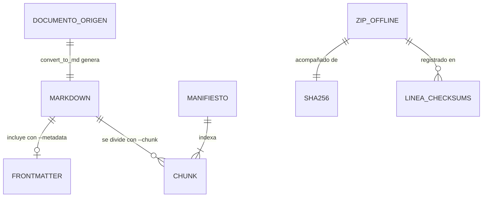

# Referencia — doc_ia

Superficie que consulta quien ejecuta u opera el tooling de doc_ia: configuración, comandos de
línea de comandos, códigos de salida y eventos de build. La API interna de cada script está en
[Referencia Técnica](../api/check_env.md).

## 1. Configuración

| Clave | Origen | Tipo | Por defecto | Descripción |
|---|---|---|---|---|
| `CUDA_VISIBLE_DEVICES` | `env` | cadena | `""` (lo fija `convert_to_md.py` al importarse si no existe) | Visibilidad de GPU para docling. `--device cpu` la fija a `""`; `--device cuda` la elimina; `--device auto` respeta un valor previo |
| `project.version` | fichero `pyproject.toml` | cadena SemVer | `0.1.0` (valor actual) | Versión usada en el nombre del ZIP (`doc_ia-docs-{versión}.zip`) y en la release `docs-v{versión}` |
| `site_dir` | fichero `mkdocs.yml` | ruta | `site` | Directorio de salida del build; `mkdocs_hooks.py` lo lee de la configuración. `build_docs_zip.py` usa `site/` fijo |
| `hooks` | fichero `mkdocs.yml` | lista de rutas | `hooks/sync_root_docs.py`, `mkdocs_hooks.py` | Hooks MkDocs cargados en cada build (ver §4) |
| `hooks.PostToolUse` | fichero `.claude/settings.json` (no versionado; plantilla en `.claude/settings.json.example`) | objeto JSON | ruff + mypy + pytest `--collect-only` sobre `Edit\|Write` | Validaciones automáticas tras cada edición en Claude Code ⚠️ |

!!! note "Sin secretos"
    doc_ia no lee credenciales ni API keys. `.gitignore` excluye `.env`, `.env.*` y `*.key`.

## 2. CLI y Comandos

### build_docs_zip.py

```bash
python scripts/build_docs_zip.py [--builder {mkdocs,zensical}] [--no-strict] [--no-build] [--output-dir DIR]
```

| Opción / Argumento | Tipo | Por defecto | Descripción |
|---|---|---|---|
| `--builder` | `mkdocs` \| `zensical` | `mkdocs` | Generador usado en el build |
| `--no-strict` | flag | desactivado (build con `--strict`) | Construye sin `--strict` |
| `--no-build` | flag | desactivado | Omite el build y empaqueta el `site/` existente |
| `--output-dir` | ruta | `dist` | Directorio del ZIP; relativo a la raíz del repositorio si no es absoluto |

Salida: `{output-dir}/doc_ia-docs-{versión}.zip`, `.zip.sha256` y una línea añadida a `CHECKSUMS.txt`.

### check_env.py

```bash
python scripts/check_env.py
```

Sin opciones. Comprueba las herramientas obligatorias (`mkdocs`, `ruff`, `mypy`, `pytest`) y
avisa de las opcionales (`docling`, `markitdown` y sus plugins, `pandoc`).

### convert_to_md.py

```bash
python scripts/convert_to_md.py <source> [opciones]
```

| Opción / Argumento | Tipo | Por defecto | Descripción |
|---|---|---|---|
| `source` | ruta (obligatorio) | — | Fichero o directorio a convertir; la salida va a `<origen>/md/` |
| `--engine` | `docling` \| `markitdown` \| `pandoc` | `docling` | Motor de conversión |
| `--dry-run` | flag | desactivado | Muestra qué se convertiría sin convertir |
| `--validate-only` | flag | desactivado | Solo validación previa (tamaño, integridad ZIP, cabeceras) |
| `--force` | flag | desactivado | Re-convierte aunque exista el `.md` de salida |
| `--metadata` | flag | desactivado | Añade frontmatter YAML con metadatos |
| `--chunk` | flag | desactivado | Genera chunks para RAG (solo `docling`) |
| `--chunk-max-tokens` | entero | `512` | Tamaño máximo de chunk |
| `--ocr` / `--no-ocr` | flag | `--ocr` | Habilita o deshabilita OCR |
| `--ocr-engine` | `auto` \| `easyocr` \| `tesseract` \| `rapidocr` | `auto` | Motor OCR de docling |
| `--ocr-lang` | lista separada por comas | `es,en` | Idiomas OCR |
| `--table-mode` | `accurate` \| `fast` | `accurate` | Extracción de tablas (docling) |
| `--image-export` | `placeholder` \| `embedded` \| `referenced` | `placeholder` | Exportación de imágenes |
| `--pdf-backend` | `docling-parse` \| `pypdfium2` | `docling-parse` | Backend PDF de docling |
| `--timeout` | entero (segundos) | `300` | Timeout por documento |
| `--device` | `cpu` \| `cuda` \| `auto` | `cpu` | Dispositivo de cómputo; `auto` solo elige GPU si `CUDA_VISIBLE_DEVICES` ya tenía un valor no vacío ⚠️ |
| `--num-threads` | entero | `4` | Hilos CPU de docling |
| `--flash-attention` | flag | desactivado | Flash Attention 2; requiere `--device cuda` o `auto` |
| `--batch-size` | entero | `1` | Documentos por lote; `>1` solo con `docling` |
| `--workers` | entero | `1` | Concurrencia por lote; `>1` solo con `docling` |

### start-server.py

```bash
python start-server.py [--port PORT] [--no-browser]
```

Se distribuye dentro del ZIP offline (lo añade `mkdocs_hooks.py`) y sirve el directorio donde está.

| Opción / Argumento | Tipo | Por defecto | Descripción |
|---|---|---|---|
| `--port` | entero | `8000` | Puerto HTTP local |
| `--no-browser` | flag | desactivado | No abre el navegador automáticamente |

### sync_root_docs.py

```bash
python hooks/sync_root_docs.py
```

Sin opciones. Copia `CHANGELOG.md` → `docs/changelog.md` y `CONTRIBUTING.md` → `docs/contributing.md`.

## 3. Errores y Códigos de Salida

| Código / Error | Origen | Cuándo ocurre | Acción recomendada |
|---|---|---|---|
| `0` | `build_docs_zip.py` | ZIP y checksums generados | — |
| `1` | `build_docs_zip.py` | `--no-build` sin `site/` existente | Ejecutar sin `--no-build` |
| `≠ 0` (propagado) | `build_docs_zip.py` | El build del generador falla (p. ej. enlace roto con `--strict`) | Corregir los avisos del build |
| `2` | `build_docs_zip.py`, `convert_to_md.py`, `start-server.py` | Opción desconocida o valor fuera de `choices` (argparse) | Revisar la sinopsis del §2 |
| `0` | `check_env.py` | Herramientas obligatorias presentes (con o sin avisos de opcionales) | — |
| `1` | `check_env.py` | Falta alguna herramienta obligatoria | Instalar las listadas (`pip install -r requirements.txt`) |
| `0` | `convert_to_md.py` | Conversión completa, validación sin errores o ningún fichero convertible | — |
| `1` | `convert_to_md.py` | Origen inexistente, motor no instalado, errores de validación o de conversión, `--device cuda` sin `nvidia-smi` | Ver el mensaje `ERROR:`; instalar el motor o cambiar `--engine` |
| `2` | `convert_to_md.py` | Combinación inválida: `--chunk`, `--batch-size >1` o `--workers >1` sin `docling`; `--flash-attention` con `--device cpu` | Ajustar las opciones |
| `0` | `start-server.py` | Servidor detenido con Ctrl+C | — |
| `1` | `start-server.py` | Puerto ocupado (excepción no capturada) 🔍 | Usar otro `--port` |
| `0` | `sync_root_docs.py` | Siempre; un fichero raíz ausente solo genera un aviso | — |

## 4. Eventos y Mensajes

| Evento / Mensaje | Productor | Consumidor | Payload / formato |
|---|---|---|---|
| `on_pre_build` | MkDocs | `hooks/sync_root_docs.py` | Configuración MkDocs (`docs_dir`); copia los ficheros raíz a `docs/` |
| `on_post_build` | MkDocs | `mkdocs_hooks.py` | Configuración MkDocs (`site_dir`); genera `site/doc_ia-docs-latest.zip` + `.sha256` |
| `PostToolUse` (`Edit\|Write`) | Claude Code | Comandos de `.claude/settings.json` | Ejecuta ruff, mypy y pytest `--collect-only`; salida truncada a 10–15 líneas ⚠️ |
| Prefijos de log `[build_docs_zip]`, `[ZIP]`, `[OK]`, `[sync_root_docs]`, `[doc_ia-docs]` | Scripts y hooks | Usuario / CI | Texto libre por stdout; sin contrato estable más allá del prefijo |

## 5. Interfaces Publicadas

| Interfaz | Tipo | Contrato fuente | Descripción |
|---|---|---|---|
| ZIP offline `doc_ia-docs-{versión}.zip` | Fichero de salida | `scripts/build_docs_zip.py::_zip` | Sitio HTML completo; nombre estable por versión |
| `doc_ia-docs-{versión}.zip.sha256` | Fichero de salida | `scripts/build_docs_zip.py::_create_checksum_files` | Formato `sha256sum`: `<hash>  <fichero>` |
| `CHECKSUMS.txt` | Fichero de salida (acumulativo) | `scripts/build_docs_zip.py::_create_checksum_files` | Una línea por build: `<hash>  <fichero>  (<ISO-8601>)` |
| Release `docs-v{versión}` | GitHub Release | `.github/workflows/docs-zip-release.yml` | ZIP + `.sha256` + `CHECKSUMS.txt`; se actualiza en cada push a `main` con cambios en `docs/` |
| Ficheros `<origen>/md/**/*.md` | Fichero de salida | `scripts/convert_to_md.py::output_path` | Estructura reflejada del origen; frontmatter opcional con `--metadata` |

## 6. Datos

doc_ia no tiene base de datos. Sus datos son los **ficheros con formato propio** que escribe el
tooling.



| Entidad | Campo | Tipo | Restricción | Sensibilidad |
|---|---|---|---|---|
| Frontmatter | `source` | cadena | Nombre del fichero origen (sin ruta) | interna |
| Frontmatter | `engine` | cadena | `docling` \| `markitdown` \| `pandoc` | pública |
| Frontmatter | `converted_at` | fecha-hora UTC | Formato `YYYY-MM-DDTHH:MM:SS` | pública |
| Frontmatter | `engine_version` | cadena | Solo con `docling`; `unknown` si no se puede leer | pública |
| Frontmatter | `title` | cadena | Solo con `docling`; nombre del documento o del fichero | interna |
| Manifiesto `_manifest.json` | `id` | entero | Correlativo desde 1 | pública |
| Manifiesto `_manifest.json` | `file` | cadena | `NNN.md` (3 dígitos) dentro de `chunks/<documento>/`, junto al `.md` convertido | pública |
| Manifiesto `_manifest.json` | `preview` | cadena | Primeros 80 caracteres del chunk | interna |
| Manifiesto `_manifest.json` | `chars` | entero | Longitud del chunk | pública |
| `.zip.sha256` | línea única | texto | `<sha256>  <nombre.zip>` (formato `sha256sum`) | pública |
| `CHECKSUMS.txt` | una línea por build | texto | `<sha256>  <nombre.zip>  (<ISO-8601 local>)`; solo se añaden líneas | pública |

La sensibilidad `interna` indica que el campo reproduce contenido o nombres del documento
convertido: hereda la sensibilidad del origen.

??? note "Evidencia"

    | Elemento | Fuente | Confianza |
    |---|---|---|
    | `CUDA_VISIBLE_DEVICES` por defecto `""` | `scripts/convert_to_md.py:30` (nivel de módulo) | ✅ |
    | `--device auto` no detecta GPU si la variable quedó en `""` | `scripts/convert_to_md.py::_detect_device` | ⚠️ |
    | `project.version` | `scripts/build_docs_zip.py::_version` | ✅ |
    | `site_dir` fijo en `build_docs_zip.py` | `scripts/build_docs_zip.py::SITE_DIR` | ✅ |
    | `hooks` de MkDocs | `mkdocs.yml::hooks` | ✅ |
    | `hooks.PostToolUse` — la plantilla no incluye `sync_root_docs.py`, que `CLAUDE.md` sí describe | `.claude/settings.json.example` | ⚠️ |
    | Opciones de `build_docs_zip.py` | `scripts/build_docs_zip.py::main` | ✅ |
    | Herramientas de `check_env.py` | `scripts/check_env.py::REQUIRED_TOOLS` | ✅ |
    | Opciones y restricciones de `convert_to_md.py` | `scripts/convert_to_md.py::_parse_args` | ✅ |
    | Opciones de `start-server.py` | `scripts/start-server.py::main` | ✅ |
    | Código `1` por puerto ocupado | `scripts/start-server.py::main` (sin manejo de `OSError`) | 🔍 |
    | Códigos de `check_env.py` | `scripts/check_env.py::main` | ✅ |
    | Códigos de `convert_to_md.py` | `scripts/convert_to_md.py::main`, `::_detect_device`, `::_parse_args` | ✅ |
    | Código `0` de `sync_root_docs.py` | `hooks/sync_root_docs.py::main` | ✅ |
    | `on_pre_build` | `hooks/sync_root_docs.py::on_pre_build` | ✅ |
    | `on_post_build` + `start-server.py` en el ZIP | `mkdocs_hooks.py::on_post_build` | ✅ |
    | Release `docs-v{versión}` | `.github/workflows/docs-zip-release.yml::build-and-publish` | ✅ |
    | Salida `md/` de `convert_to_md.py` | `scripts/convert_to_md.py::output_path` | ✅ |
    | Campos del frontmatter | `scripts/convert_to_md.py::_build_metadata_basic`, `::_convert_with_docling` | ✅ |
    | Serialización YAML del frontmatter | `scripts/convert_to_md.py::_format_frontmatter` | ✅ |
    | Manifiesto y chunks | `scripts/convert_to_md.py::_run_chunking` | ✅ |
    | Formato `.sha256` y `CHECKSUMS.txt` | `scripts/build_docs_zip.py::_create_checksum_files` | ✅ |
